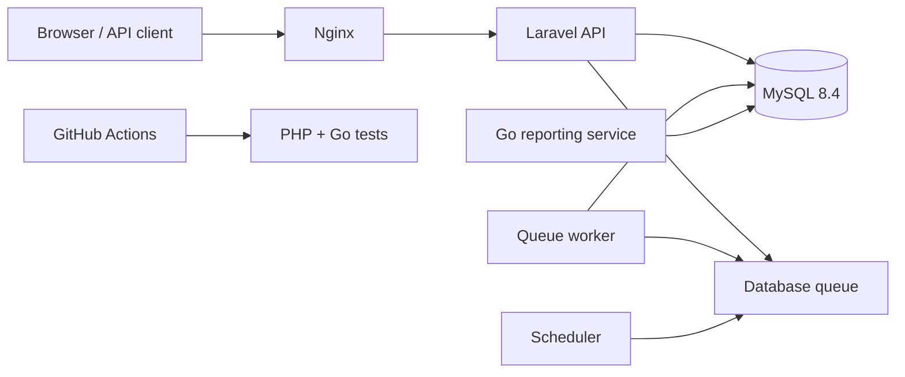

# System Architecture

Laravel owns authentication and transactional business operations. MySQL is the source of truth. The Go service is read-only and handles reporting queries. The queue worker processes slow notifications, while the scheduler creates recurring jobs.

## Important decisions

- Database transactions and row locks protect stock changes.
- Named permissions are enforced by API middleware.
- Audit logs record successful changes without storing passwords.
- The Go service never changes transactional data.
- Production containers do not mount the source directory from the host.
