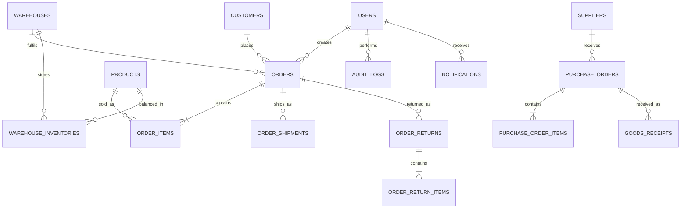

# Database Overview

Stock is represented both by total product quantity for compatibility and by warehouse balances for operational accuracy. Every stock-changing workflow updates both values inside a transaction.
